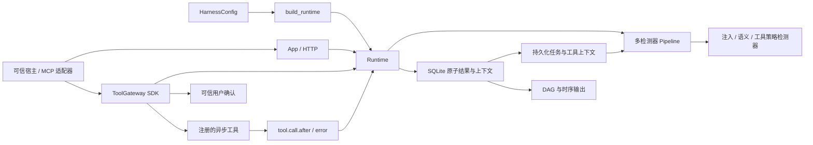

# 框架基础设施设计

日期：2026-10-02。范围：题目 5 的基础设施升级；不将接口存在等同于五项核心能力验收通过。

## 需求对齐

| 赛题能力 | 本次提供的基础设施 | 后续功能 |
|---|---|---|
| 多源注入识别 | 用户、外部资源、工具描述/结果、记忆事件；SourceSpan | 各来源检测器、宿主采集适配器、记忆跨会话污染检测 |
| 意图—计划—工具对齐 | 持久化 original_task、plan、history、resources；EvaluationContext | 语义意图模型、偏离指标、证据解释、敏感信息流关联 |
| DSL 与三态决策 | JSON 条件 DSL、多检测器合并、工具网关、确认生命周期 | 五类完整工具策略、路径真实解析、命令等价分析、信任域与凭据传播规则 |
| MCP 与子 Agent 溯源 | 根会话、父事件、MCP/父 Agent/call 标识、来源区间、影响对象、DAG/时序源码 | 真实代理采集、完整证据库、token 来源核验与交互式溯源 UI |
| 对抗鲁棒性 | 检测器扩展接口，保留原始区间；Stage 2 normalize-v1 | 多语言、同形字符/零宽、拆分、多轮、编码、注释、稀释、语义伪装的算法与攻击验证 |

## 模块边界



- `bootstrap.py` 负责配置校验、数据/策略加载和对象组装。`App(runtime)` 不再加载数据，测试可以注入 Runtime。
- `domain.py` 负责事件契约、来源区间、调用拓扑和影响对象；不承担检测算法。
- `Runtime` 负责序号、幂等、根会话串行化、跨根并发、超时及最终结果提交。
- `Pipeline` 执行多个检测器，收集各自风险与执行状态，按 `BLOCK > REVIEW > ALLOW` 合并。单个检测器失败不丢弃其他成功检测器的 REVIEW/BLOCK。
- `ToolGateway` 承担真正的执行入口；仅调用 HTTP evaluate 不会拦截工具。
- `AuditRepository` 持久化结果、上下文、确认、执行领取和调用链。`ContextStore` 保留为兼容的内存上下文工具；运行时研判读取 SQLite 的持久化状态，不依赖旧缓存。

## 事件契约

原有六种事件继续可用。新增 `agent.task.started`、`agent.plan.updated`、`resource.content.received`、`tool.registered`、`memory.read/write`、`subagent.dispatch.before/after`。

约定的 payload：

| 事件 | payload |
|---|---|
| 用户输入 | `prompt: string` |
| 任务开始 | `intent: string` |
| 计划更新 | `steps: string[]`，最多 64 项 |
| 工具调用前 | `tool_name: string, arguments: object` |
| 外部资源/记忆/工具结果 | 内容字段及可选 `resource: {uri, sensitivity}` |
| 网关调用后 | `tool_name, result, resource` |

`sources` 包含 `source_id`、`kind`、可选 URI 与成对的 `char_start/end`、`token_start/end`。区间使用左闭右开，指向适配器提供的原始内容；规范化后不能继续沿用原区间定位变换后的文本。适配器负责 tokenizer、实际区间校验和原文留存。

`trace` 包含 `root_session_id`、`parent_agent_id`、`mcp_server_id`、`call_id`。`impacts` 包含 `kind`（file/network/git/credential/agent）、`target`、`operation`。这些是采集协议，不证明字段声明的内容真实或敏感。

单 Agent 默认根标识 `agent_id:session_id`（两个分量分别做 URL 转义），避免不同 Agent 的同名会话及分隔符组合互相污染。主/子 Agent 共享显式根标识后，共用研判历史，各自仍按 `(agent_id, session_id)` 维护序号。父事件必须先记录且属于同根，因此新增的显式因果边不会形成环。

可信适配器负责产生任务、来源、敏感标签、拓扑和真实工具参数。不得让模型输出或外部资源直接决定这些可信字段。HTTP 可配置适配器认证；当前没有多租户权限隔离。

## 检测器接口

旧检测器继续实现 `execute(event)`。需要历史的检测器实现：

```python
async def execute_with_context(event, context: EvaluationContext):
    # context.original_task / plan / history / resources / version
    return HandlerResult(name, "SUCCEEDED", duration_ms, decision=decision), signals
```

每个检测器得到独立的上下文快照，不应改写输入事件。RiskSignal 可关联 `source_ids`、`evidence_event_ids`、`rule_id`。检测器版本及数据集哈希写入结果，幂等重放恢复完整结果，而不重新运行算法。

历史与资源各保留最近 128 项，持久化上下文最多 256 KiB；任务文本最多 4096 字符。这是有界上下文基础设施，未实现全历史的语义检索或敏感数据传播分析。完整事件拓扑保留在审计中。

## DSL 与决策执行

策略 JSON 必须包含 `version`、`default_decision`、`rules`。规则必须包含 `id`、`when`、`decision`、`severity`、`message`。条件支持 `all`/`any` 和 `eq`、`in`、`contains`、`glob`、`exists`，读取 `event.*`、`tool.*`、`context.*`。加载时校验结构，不执行 Python 表达式。

`examples/policies/demo.json` 仅演示配置与执行闭环。`glob` 只做斜杠/大小写统一；不解析符号链接、路径穿越或真实权限。`contains` 是文本条件，不是语义意图分析。工具适配器和后续策略事实提取层必须补充规范路径、目标域名、等价命令及敏感来源关系。

检测器故障按配置执行 fail_open/fail_closed/fail_review，但成功检测器的更高风险决策仍保留。SDK 执行网关始终拒绝 degraded 结果和全部 SKIPPED 的结果。

工具 REVIEW 生成持久化确认，默认有效期 300 秒。确认必须来自可信 UI/宿主回调，或使用独立确认凭据的 HTTP 通道。确认绑定完整事件指纹；拒绝、过期、参数变化均不能执行。确认期间上下文版本变化时返回 CONTEXT_CHANGED，调用者需提交新事件重新研判。

领取执行与消费确认在同一 SQLite 事务内完成。重复事件不会再次执行工具；进程在领取后崩溃时，框架不会猜测外部动作是否已完成，必须核查。此机制提供持久化“最多一次尝试”，不承诺分布式 exactly-once。

## 恢复、存储与部署边界

- 服务从持久化终态事件恢复序号。返回的故障降级结果也是终态，会占用序号并在重试时重放；修复后重新检测需提交新事件。
- 取消/未提交最终结果的事件可用原事件内容恢复，复用审计记录。最终结果、序号依据与上下文在一个事务中提交。
- 原 Stage 1/2 数据库使用附加表升级，不删除旧表和记录。旧成功结果支持重放和继续序号，但历史记录不具备新来源与拓扑信息。
- 当前运行模型是单进程、单 Runtime。SQLite WAL 不代表支持多个服务进程共享调度；跨进程锁、分布式状态和并行部署另行设计。
- 默认审计不存原始 payload，仅存摘要与来源/影响信息。上下文做尽力脱敏，不能宣称识别所有凭据格式。数据库文件应由部署者保护；完整原文证据库、加密、访问控制及保留周期待实现。
- HTTP/Claude 提示词桥接是监测接口。SDK 注册工具已经具备执行拦截；真实 Claude/Cursor/MCP 等适配器尚未完成。
- DAG/时序图输出 Mermaid 源码及结构化数据，未提供完整交互式可视化页面。
